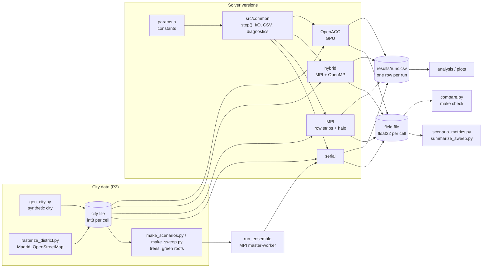

# 2. Software architecture

Draft by P1 (updated 22 Nov 2026). It describes `main` with P4's PR #16 and P5's PR #17
(tested together: every check passes, hybrid and MPI bit-identical to serial).

## 2.1 Overview

The simulator is one C code base with four versions of the same solver (serial, MPI,
hybrid MPI + OpenMP, OpenACC). All versions share one header of physical constants, one
heat-update kernel and one set of file formats, so they differ only in *how the work is
distributed*, never in *what is computed*. Around the solver sit Python and C tools
that generate cities, build scenario sweeps, run ensembles and analyse results.

(The same diagram as an image for the report: `docs/figures/architecture.png`.)

## 2.2 Repository layout

| Folder | Contents | Owner |
|---|---|---|
| `src/params.h` | all physical constants: coefficient table per cell type, air temperature, solar cycle, hot-area threshold (29 °C) | P1 |
| `src/common/` | shared kernel `step()`, boundary conditions, file I/O, synthetic city, CSV writer, timer, diagnostics | P1 (diagnostics P5) |
| `src/serial/`, `src/mpi/`, `src/hybrid/`, `src/openacc/` | one driver per version | P1, P3, P4, P5 |
| `src/opt/` | serial optimisation study (kernel variants, self-checking) | P1 |
| `benchmarks/stream/` | STREAM memory-bandwidth benchmark (the hardware limit for the stencil) | P4 |
| `tools/` | city generation, scenarios, sweep, ensemble runner, candidate scoring, `compare.py` | P2, P1 |
| `tests/` | unit tests, halo tests, reference output, `check.sh` | all |
| `slurm/` | one script per experiment; each compiles on the compute node | all (templates P5) |
| `env/` | `modules.sh` (cpu / gpu environments) and the cluster survey | P5 |
| `results/`, `analysis/` | `runs.csv`, logs, plots and the scripts that make them | all |
| `docs/` | interface contract, physics note, results write-ups, this report | all |

The **interface contract** (`docs/contract.md`) fixes the command line, file formats,
CSV columns and verification rules for every version. It was agreed in week 1 and changed
only by pull request with everyone's agreement.

## 2.3 The shared kernel

**Model.** Each cell is updated explicitly with
`T' = T + α_c (avg4 − T) + S(t)·a_c − k_c (T − T_air)`
(average of the four neighbours, solar heating, cooling to the air; see the physics note).
Two buffers are swapped after every step (ping-pong), so every new value depends only on
old values and all cells of a step can be updated in any order, in parallel.

**Memory layout.** Temperatures are float32 arrays of (nx + 2) × (ny + 2), row-major,
with a one-cell **ghost frame**; interior cell (i, j) is at `IDX(i, j, nx) = (j+1)(nx+2) + (i+1)`.
The cell types are an unpadded int8 array (1 byte per cell). `step()` reads the ghost frame
and writes only interior cells; *whoever calls it fills the ghosts first*:

| Version | Ghost rows between parts of the grid | Ghost cells at the real domain edge |
|---|---|---|
| serial | — | `apply_boundary()` on all four sides |
| MPI | halo exchange with the neighbouring ranks | `apply_boundary()` on the sides that are real edges |
| OpenACC | — | `apply_boundary()`, run on the GPU |

This keeps the kernel identical in every version: an MPI rank runs exactly the same
`step()` on its strip as the serial code runs on the whole grid.

**One kernel, three builds.** `src/common/step.c` is compiled three ways, chosen at compile time:

- **AVX-512** (cluster CPUs with `-march=native`): the six per-type coefficients sit in vector
  registers and are looked up with one permute instruction per coefficient, 16 cells at a time.
  This made the serial solver about 4× faster (Section 5.1).
- **scalar** (CPUs without AVX-512): a plain table lookup per cell.
- **OpenACC** (`nvc -acc`): one GPU loop over all cells (`parallel loop collapse(2)`).

The AVX-512 and scalar builds perform the same floating-point operations in the same order
and give **bitwise-identical** results; `step_kernel_name()` records which build ran.
`step_rows(j0, j1)` updates a range of rows, so threads (OpenMP) or communication overlap can
work on parts of the grid with the same kernel.

## 2.4 The parallel versions

**MPI (P3).** The grid is split into strips of whole rows (the first `ny mod p` ranks get one
extra row). Each rank allocates only its strip plus ghost rows, generates or reads only its own
rows of the city (the synthetic city is a pure function of (i, j, seed), and city files are read
by offset), and per step:

1. exchanges one row with each neighbour (`MPI_Sendrecv`; `MPI_PROC_NULL` at the domain edge),
2. applies the boundary condition on its real edges,
3. calls `step()`, then swaps buffers.

With `--overlap` (P3) the halo messages are started first (non-blocking), the interior rows that do
not need ghost data are updated with `step_rows()` while the messages travel, and the two boundary
rows are updated once the halo has arrived; results stay bitwise identical.

Output is either gathered on rank 0 (`MPI_Gatherv`) or written in parallel into one shared
file with MPI-IO (`--io mpiio`, P5); both give byte-identical files. Diagnostics
(peak, mean, hot share) are combined with `MPI_Allreduce`. Because every rank performs exactly the
serial operations on its cells, MPI results are bitwise identical to serial for any rank count.

**Hybrid MPI + OpenMP (P4).** The grid is split into rectangular **2D blocks** with an MPI
Cartesian topology (`MPI_Cart_create`), so each rank exchanges four edges (rows and columns,
`src/hybrid/halo2d.c`) instead of two rows; blocks have a shorter perimeter than strips, so less data
is communicated per cell. Each rank reads or generates only its block of the city. Inside a rank,
OpenMP threads share the rows of the block (`parallel for`), each calling `step_rows()`, so they keep
the AVX-512 kernel. Two cache-blocking variants can be compiled in instead (`-DSTEP_TILED`,
`-DSTEP_TILED_2D` with a tile size): they update the block in tiles of columns, or of rows × columns,
so neighbouring rows are still in cache when they are reused. All variants equal serial bit for bit
in our tests.

**OpenACC (P5).** The same `step.c` is compiled for the GPU. In the default *resident* mode the
city and both grids are copied to the GPU once, all steps run there and the result is copied
back once (`--bc-once` also fills the fixed boundary only once, leaving one kernel launch per
step); the *naive* mode copies the data around every step and exists to measure what data
residency saves. Copy time is reported separately (`time_transfer`).

**Ensembles (P2).** For the scenario study, many independent serial runs are needed (strategies ×
budgets × seeds). `tools/run_ensemble.c` is an MPI master–worker program: rank 0 hands out jobs
(static, cyclic or dynamic scheduling) and each worker runs the serial solver as a child process.

## 2.5 Data formats and results

| File | Format |
|---|---|
| City | int32 nx, int32 ny (little-endian), then nx·ny int8 cell types (0 road, 1 building, 2 grass, 3 tree, 4 water, 5 green roof) |
| Temperature field | int32 nx, int32 ny, then nx·ny float32 (°C), row-major |
| `results/runs.csv` | one row per run, the same 18 columns for every version: tag, version, grid, steps, nodes, ranks, threads, GPUs, total / compute / communication / I/O / transfer time, checksum, git commit, Slurm job ID, node |

Every row records the git commit, Slurm job ID and node, so each number in the report
can be traced to the code and machine that produced it (`REPRODUCE.md` lists the commands).

## 2.6 Verification

Correctness is checked at four levels, all run with `make test`, `make check` and `make test-mpi`:

1. **Unit tests of the kernel and I/O** (`tests/test_serial.c`): a uniform field stays uniform,
   a hot spot spreads symmetrically, heat is conserved with insulated edges, values stay within
   their initial range, unstable coefficients are rejected, file round trips are exact.
2. **Reference output**: the serial result for a fixed case (seed 42, 256², 200 steps) is stored in
   `tests/ref/`; any change to the physics or the kernel shows up as a difference.
3. **Version against serial** (`tests/check.sh` with `tools/compare.py`): MPI must be **bitwise
   identical**; versions that may change the order of floating-point operations (OpenMP SIMD,
   FMA, GPU) must satisfy `max |a − b| ≤ 10⁻⁵ · max |T|`. A fixed 10⁻⁵ absolute tolerance is below
   float32 resolution at 25–30 °C (we measured differences of 4·10⁻⁵ from FMA alone).
4. **Halo-exchange tests** (`tests/test_halo.c`): on 1, 2, 3 and 5 ranks, including strips of
   one row and runs across two nodes, every rank's ghost frame and one step must equal the
   corresponding rows of the serial grid exactly. Deliberately broken halo code is detected.

## 2.7 Workflow

Each person works on their own branch; nothing reaches `main` without a pull request approved by
the next person in a fixed review chain (P1 → P2 → P3 → P4 → P5 → P1). Experiments run only as
Slurm batch jobs that compile on the compute node (`-march=native` must see that CPU; the login
node has an older CPU) and repeat each configuration three times.
